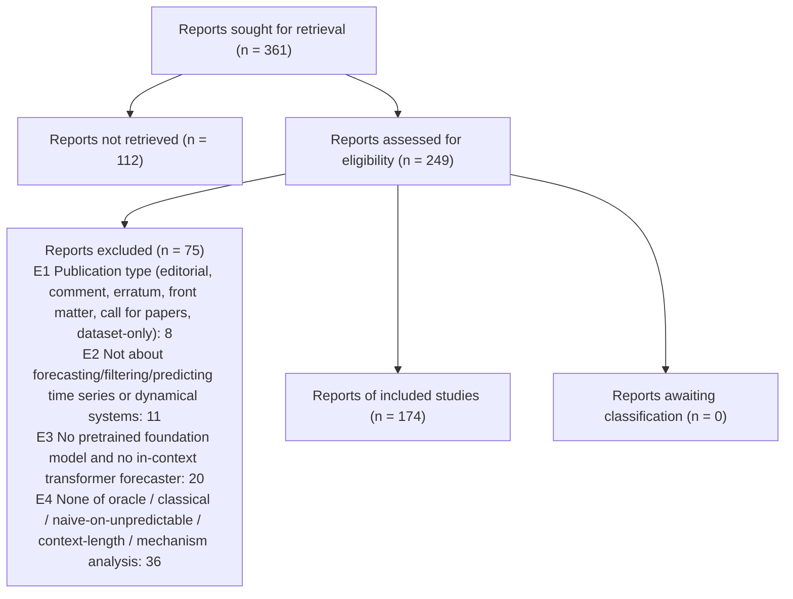

# PRISMA 2020 counts - full-text stage



```json
{
 "stage": "ft",
 "tool": "sr-screener 1.0.0",
 "complete": true,
 "pending_records": 0,
 "pending_ta_records": 0,
 "pending_ta_qc_records": 0,
 "fulltext_set_out_of_date": false,
 "state_problems": [],
 "reports_sought_for_retrieval": 361,
 "reports_not_retrieved": 112,
 "reports_assessed": 249,
 "reports_to_assess": 249,
 "reports_excluded": 75,
 "excluded_by_reason": {
  "E1 Publication type (editorial, comment, erratum, front matter, call for papers, dataset-only)": 8,
  "E2 Not about forecasting/filtering/predicting time series or dynamical systems": 11,
  "E3 No pretrained foundation model and no in-context transformer forecaster": 20,
  "E4 None of oracle / classical / naive-on-unpredictable / context-length / mechanism analysis": 36
 },
 "reports_unclear_awaiting_classification": 0,
 "studies_included_reports": 174,
 "agreement": {
  "n": 249,
  "both_advance": 167,
  "both_exclude": 72,
  "a_only_advance": 5,
  "b_only_advance": 5,
  "observed_agreement": 0.9598,
  "kappa": 0.906,
  "pabak": 0.92
 },
 "decided_by": {
  "A+B": 239,
  "ADJ": 10
 }
}
```
