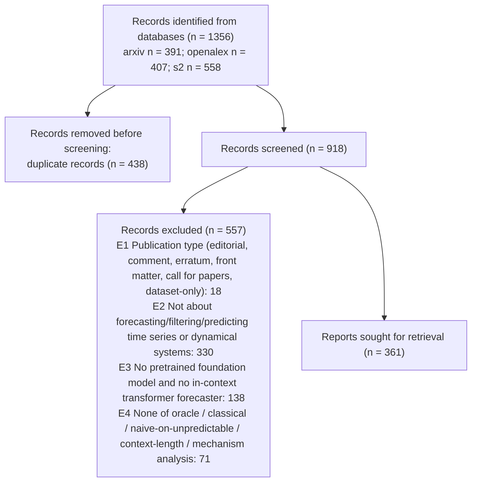

# PRISMA 2020 counts - title/abstract stage



```json
{
 "stage": "ta",
 "tool": "sr-screener 1.0.0",
 "complete": true,
 "pending_records": 0,
 "state_problems": [],
 "identified_by_database": {
  "arxiv": 391,
  "openalex": 407,
  "s2": 558
 },
 "identified_total": 1356,
 "duplicates_removed": 438,
 "records_screened": 918,
 "records_to_screen": 918,
 "records_excluded": 557,
 "excluded_by_code": {
  "E1": 18,
  "E2": 330,
  "E3": 138,
  "E4": 71
 },
 "reports_sought_for_retrieval": 361,
 "advanced_include": 162,
 "advanced_unclear": 199,
 "advanced_outside_allowed_languages": 0,
 "agreement": {
  "n": 918,
  "both_advance": 298,
  "both_exclude": 575,
  "a_only_advance": 21,
  "b_only_advance": 24,
  "observed_agreement": 0.951,
  "kappa": 0.892,
  "pabak": 0.902,
  "conflicts": 45,
  "resolved_by": {
   "A+B": 848,
   "ADJ": 44,
   "QC": 26
  }
 },
 "decided_by": {
  "A+B": 848,
  "ADJ": 44,
  "QC": 26
 }
}
```
